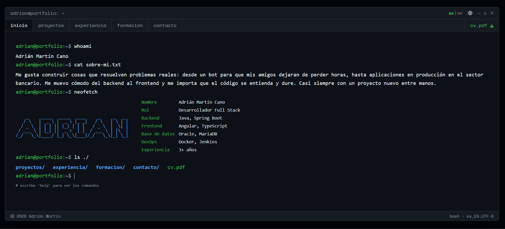

<p align="right"><a href="README.md">🇪🇸 Español</a> · <b>🇬🇧 English</b></p>

```
adrian@portfolio:~$ neofetch

    _     ____   ____   ___     _     _   _     Name        Adrián Martín Cano
   / \   |  _ \ |  _ \ |_ _|   / \   | \ | |    Role        Full Stack Developer
  / _ \  | | | || |_) | | |   / _ \  |  \| |    Backend     Java · Spring Boot
 / ___ \ | |_| ||  _ <  | |  / ___ \ | |\  |    Frontend    Angular · TypeScript
/_/   \_\|____/ |_| \_\|___|/_/   \_\|_| \_|    Focus       Production · banking + real clients
```

**Full Stack Developer** — Java/Spring Boot + Angular. I build and maintain applications **in production** (banking sector and real clients), from backend to frontend. I care about code that's easy to understand and built to last, and I almost always have a new side project on the go.

<p>
  <a href="https://www.codeadrianmc.dev">
    
  </a>
  <a href="https://www.linkedin.com/in/adrianmartincano/">
    
  </a>
  <a href="mailto:hello@codeadrianmc.dev">
    
  </a>
  <a href="https://www.codeadrianmc.dev/AdrianMartinCano.pdf">
    
  </a>
</p>

```
adrian@portfolio:~$ cat now.txt

Now          Agarrao (my household spending app) and client sites built on my libraries
Next         Publishing my libraries on npm and Maven Central, for anyone to use
In depth     Angular · Spring Batch · DevOps (deploy, architecture)
Homelab      Self-hosted: Docker · Coolify · WireGuard · Cloudflare
Languages    Spanish (native) · English
Status       Open to new opportunities
Coffee/day   ∞
Music        always on while I code
PS           Covered in tattoos, just so you're not surprised 😉
```

---

## 📌 Featured projects

**[Agarrao](https://agarrao.pimon.dev)** — PWA for household spending: shared shopping list, receipts that read themselves (PDF or photo), price per unit across supermarkets with the equivalent store brand, expenses with charts and petrol stations by price.
`Angular` · `Ionic (PWA)` · `Spring Boot` · `PostgreSQL` · `Flyway` · `Tesseract`
🔗 [Live app](https://agarrao.pimon.dev) · [Repo](https://github.com/AdrianMartinCano/agarrao)

**Shared library ecosystem** — 20 Angular libraries and 17 Spring Boot modules (auth, shop, CMS, blog, forum, bookings, restaurants, events…) that I use to build client websites in a fraction of the time. In production in all my projects.
`Spring Boot` · `Angular` · `Nx` · `Maven multi-module` · `GitHub Actions` · `Architecture`
🔗 [Backend](https://github.com/AdrianMartinCano/libreriasBackend) · [Frontend](https://github.com/AdrianMartinCano/librerias-frontend)

**[La Caja de Latón](https://lacajadelaton.com)** — Website **in production** for a publisher: book sales with Stripe, blog and community forum, built on my libraries and deployed on a VPS with Coolify.
`Production` · `Client` · `Stripe` · `Angular` · `Spring Boot`
🔗 [Live site](https://lacajadelaton.com) · private code (client)

**[WoW Auction Analyzer](https://subasta.codeadrianmc.dev)** — Full-stack platform that analyzes the World of Warcraft auction house, detects market opportunities and notifies via Discord in real time.
`Java` · `Spring Boot` · `Spring Batch` · `Angular` · `Discord (JDA)` · `PostgreSQL`
🔗 [Live demo](https://subasta.codeadrianmc.dev) · [Repo](https://github.com/AdrianMartinCano/wow-analizer)

**Rumbo Fijo** — Internal app (PWA) for a removals company, **in production**: team calendar, business accounts, push notifications and role-based permissions enforced on the server (employees never see clients or prices).
`Production` · `Client` · `Angular` · `Ionic (PWA)` · `Spring Boot` · `Web Push`
🔗 [Screenshots and architecture](https://github.com/AdrianMartinCano/rumbo-fijo-escaparate) · private code (client)

**[Artesanos del Torno](https://artesanosdeltorno.es)** — Official website **in production** for a national craftsmen association: admin panel, Stripe e-commerce and automated newsletter.
`Production` · `Client` · `Stripe` · `E-commerce`
🔗 [Live site](https://artesanosdeltorno.es) · [Repo](https://github.com/AdrianMartinCano/artesanosdeltorno)

**[Portfolio (terminal)](https://www.codeadrianmc.dev)** — This site: Angular frontend with a Linux terminal concept and its own Spring Boot API. Multi-language, prefetch, interactive commands.
`Angular` · `TypeScript` · `Tailwind` · `Spring Boot`
🔗 [Live site](https://www.codeadrianmc.dev) · [Front](https://github.com/AdrianMartinCano/portfolio) · [Back](https://github.com/AdrianMartinCano/portfolio-back)

---

## 🖥️ The portfolio in action

<p align="center">
  <a href="https://www.codeadrianmc.dev">
    
  </a>
</p>

---

## 🧰 Stack

```
adrian@portfolio:~$ cat stack.txt

Backend       Java · Spring Boot · Spring Batch · JPA / Hibernate
Frontend      Angular · TypeScript · RxJS · Signals · Ionic (PWA) · Tailwind CSS
Data          PostgreSQL · MariaDB · Oracle · Flyway
DevOps        Docker · Jenkins · Git · Coolify · Vercel · Render
APIs / other  Discord (JDA) · Stripe · Resend · GitHub Packages
```

---

## 📈 GitHub

<p align="center">
  
  
</p>

<div align="center">
  
</div>

---

<p align="center">
  <code>adrian@portfolio:~$ open <a href="https://www.codeadrianmc.dev">www.codeadrianmc.dev</a>&nbsp;&nbsp;&nbsp;# let's talk?</code>
</p>
